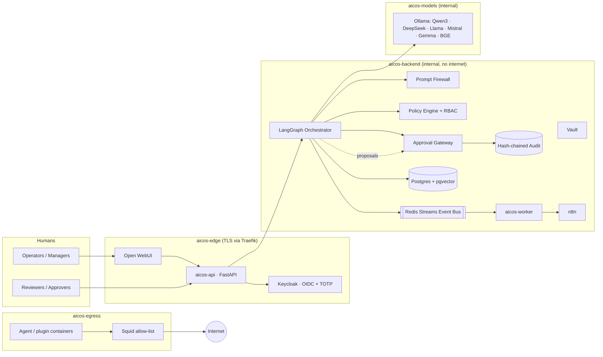
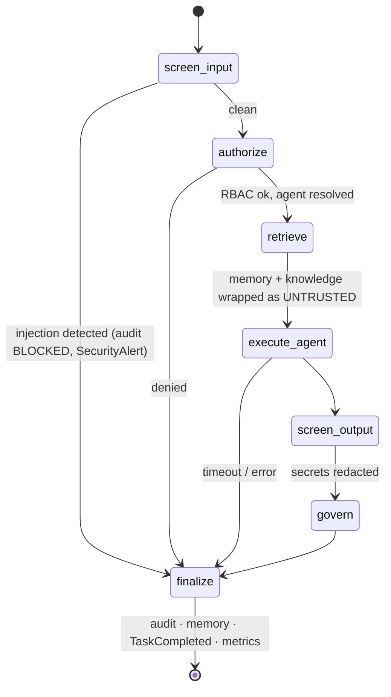
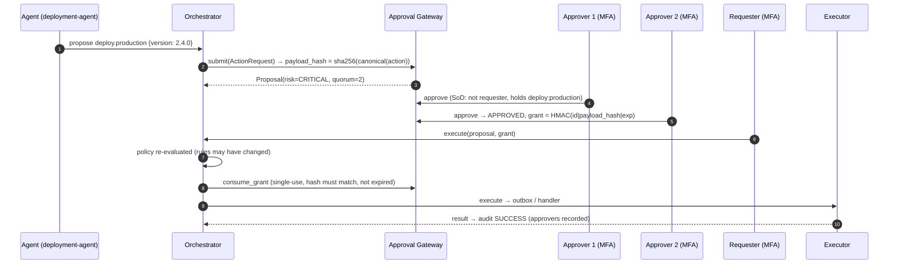
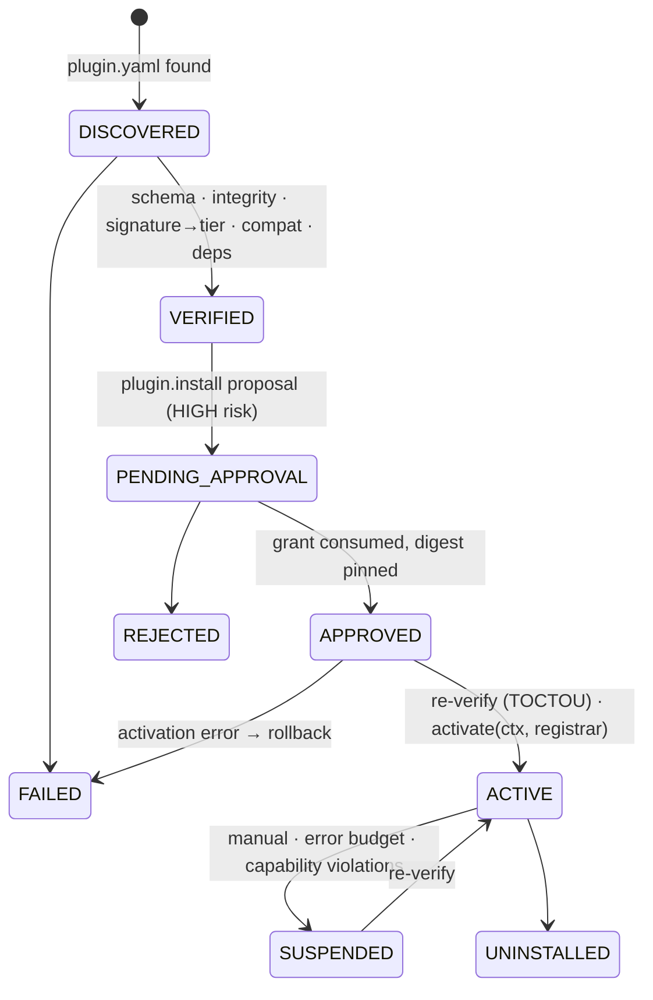
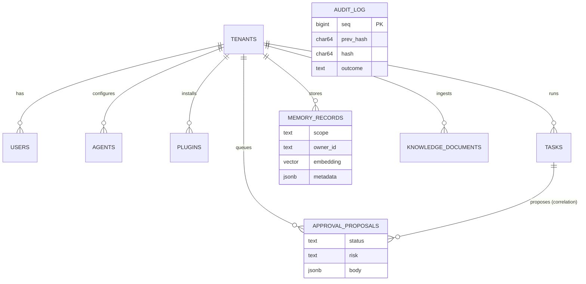

# AICOMPANY-OS Architecture

> **One rule drives the design: no agent can cause an effect.** Agents are pure functions that *propose*.
> Only the orchestrator turns proposals into effects, and only after RBAC, policy, approval and audit.

## 1. System context

## 2. Clean architecture layers

| Layer | Package | Depends on | Notes |
|---|---|---|---|
| Domain | `aicos.domain` | nothing | Principals, permissions, roles, errors, canonical hashing |
| Application | `aicos.security`, `approvals`, `orchestrator`, `agents`, `memory`, `knowledge`, `llm`, `plugins`, `compliance` | domain + **protocols** | All I/O behind `Protocol`s (`AuditStore`, `VectorStore`, `EventBus`, `LLMProvider`, `SecretProvider`, `ProposalRepository`) |
| Infrastructure | `aicos.infrastructure` | application protocols | Postgres/pgvector, Redis Streams, Ollama, Vault |
| Composition root | `aicos.container` | everything | The **only** place that picks concrete adapters (DI) |
| Interface | `aicos_api`, `services/worker`, `apps/openwebui-pipe` | container | HTTP, background jobs, chat UI bridge |

SOLID in practice: every adapter is substitutable (L), protocols are narrow (I), services receive their
dependencies (D), and new agents / actions / models / loaders arrive through the plugin registrar without
editing core (O).

## 3. Orchestrator (LangGraph)

`govern` runs for **each** proposed action:

1. action type must be in the agent's `tools` list
2. the **platform** maps action → required permission (`ACTION_PERMISSIONS`); an agent lying about the permission is denied
3. payload scanned for credentials
4. `PolicyEngine.evaluate(actor=agent, on_behalf_of=human)` with **delegation = intersection** of agent and human permissions
5. `ALLOW` → executor · `REQUIRE_APPROVAL` → proposal · `DENY` → audit + `ActionDenied` event

## 4. Human approval gateway

Invariants (all unit-tested in `tests/unit/test_approvals.py`): humans only · MFA · separation of duties ·
reviewer must hold the target permission for HIGH/CRITICAL · quorum 2 for CRITICAL · any rejection is final ·
grants are payload-bound, single-use and expire (default 1h) · proposals expire (default 24h).

## 5. Security model

| Control | Implementation |
|---|---|
| Zero trust | Every request authenticated (OIDC JWT, JWKS, aud/iss/exp). Service-to-service calls HMAC-signed with nonce + skew window |
| Least privilege | Agents hold explicit permissions only; `AGENT_FORBIDDEN_PERMISSIONS` stripped at RBAC **and** rejected at spec validation |
| Confused deputy | Agent effective permissions = agent ∩ delegating human |
| Prompt injection | `PromptFirewall`: normalisation (NFKC, zero-width, bidi), homoglyphs, base64/hex decode-and-rescan, 17 signatures across 5 threat classes, stricter threshold for untrusted content, quarantine at ingestion, delimiter-defused wrapping of retrieved text |
| Output safety | Secret detection + redaction on agent output and action payloads |
| Audit | HMAC-SHA256 hash chain; Postgres trigger blocks UPDATE/DELETE/TRUNCATE; app role has INSERT/SELECT only; worker anchors head hash externally |
| Tenancy | `tenant_id` checked in every service + Postgres RLS |
| Secrets | Vault (AppRole, KV v2, transit for PII) → Docker secrets → env (dev only). Production boot refuses dev auth, echo models, missing keys, TLS off |
| Sandboxing | Non-root, read-only rootfs, `cap-drop ALL`, no-new-privileges, pids/cpu/mem limits, `network=none` or egress proxy, digest-pinned images, gVisor for community plugins |
| Supply chain | CodeQL, Semgrep (+ custom AICOS rules), Trivy fs+image, pip-audit, Safety, OWASP Dependency-Check, Dependabot, cosign-signed images with SBOM + provenance |

## 6. Plugin architecture (summary — full spec in [docs/plugins/README.md](docs/plugins/README.md))

## 7. Memory & knowledge

| Scope | Owner | Default TTL | Visible to |
|---|---|---|---|
| `short_term` | task run | 1h | that run |
| `conversation` | thread | 30d | that thread |
| `agent` | agent id | ∞ | **only** that agent |
| `project` | project id | ∞ | agents on the project |
| `company` | `company` | ∞ | everyone in tenant |
| `long_term` | human id | ∞ | runs on behalf of that human |

Ingestion: load (PDF, DOCX, TXT, MD, CSV, JSON/JSONL, HTML, websites, Git repos) → size/emptiness checks →
sha256 dedupe → structure-aware chunking → secret redaction → injection scan (quarantine) → PII tagging →
embed (BGE-M3 default) → pgvector HNSW. Retrieval never returns quarantined chunks and always wraps text as untrusted.

## 8. Data model

Full DDL: [`infra/postgres/init/001_schema.sql`](infra/postgres/init/001_schema.sql).

## 9. LLM router

| Task | Primary | Fallbacks |
|---|---|---|
| coding | `deepseek-coder-v2:16b` | `qwen3-coder:30b`, `qwen3:14b` |
| reasoning | `deepseek-r1:14b` | `qwen3:14b` |
| business | `qwen3:14b` | `llama3.1:8b` |
| fast | `mistral:7b` | `gemma3:4b` |
| embedding | `bge-m3` | `nomic-embed-text`, `jina-embeddings-v2` |

Constraints: `require_local` (default **true** — data never leaves), max cost, min context, min quality.
Per-model circuit breaker. New models: `models/registry.yaml` or an `llm_provider` plugin.

## 10. Event bus

Typed `DomainEvent` (id, type, tenant, source, correlation_id, schema_version). Core types are PascalCase;
plugin types are namespaced (`HubSpot.ContactQueued`) and plugins **cannot** publish core types — preventing
forged `ApprovalGranted`. Dev: in-memory bus with retries + dead letters. Prod: Redis Streams with consumer
groups, max-delivery DLQ, horizontal workers. Interface is broker-agnostic (NATS/Kafka adapters fit the same protocol).

## 11. Deployment topology

See [`docker-compose.yml`](docker-compose.yml): 4 networks (`edge`, `backend` internal, `models` internal,
`egress` internal + proxy), Docker secrets, read-only containers, healthchecks. Kubernetes base with
restricted PodSecurity, default-deny NetworkPolicies, HPA, PDB and Vault agent injection lives in `infra/k8s/base`.
