# RevenueOS

Revenue first: find → analyze → score → audit → propose → outreach → follow up → pipeline → recurring clients.
Package: `revenueos/src/revenueos` · API: `/v1/revenue/*` · Schema: `infra/postgres/init/002_revenueos.sql`

```mermaid
flowchart LR
  D[Business discovery<br/>OSM / CSV / APIs] --> L[(leads)]
  L --> A[Business Analyzer<br/>SEO · speed · CTA · mobile · chat · pixels · reviews · social]
  A --> S[Scoring engine<br/>0-100 · Platinum→Ignore]
  S --> C[Campaign draft]
  C -->|campaign.send| G{{Human approval<br/>bound to lead list + template hash}}
  G --> F[Follow-up engine<br/>Day 1 / 3 / 7 / 14]
  F -->|replied| P[Pipeline: Opportunity → Meeting → Proposal → Negotiation]
  P -->|contract.send| G2{{Human approval}}
  G2 --> W[Won → MRR / ARR]
  W --> CS[Client success: reports · renewals · upsell]
```

## Lead scoring (exact rubric)

| Category | Rule | Points |
|---|---|---|
| SEO | none / weak (<40) / average (<70) / strong | 25 / 15 / 5 / 0 |
| Website | missing site | 20 |
| | page speed < 50 · no CTA · bad mobile · outdated design | 15 · 10 · 10 · 10 |
| Reputation | <20 / 20-50 / 50-100 / 100+ reviews | 15 / 10 / 5 / 0 |
| Social | no Facebook · no Instagram · inactive (>30 days) | 5 · 5 · 5 |
| Advertising | no Google Ads · no social ads | 5 · 5 |
| Revenue potential | ideal / mid-market / enterprise (configurable `ICP`) | 20 / 15 / 5 |

Capped at 100. **Unknown signals score 0**, so leads are never inflated on data we didn't observe.
Grades: 90+ Platinum · 75 Gold · 60 Silver · 40 Bronze · <40 Ignore (never emailed).

## Follow-up automation (Sequence 1)

| Day | Condition | Step | Subject |
|---|---|---|---|
| 1 | — | `initial` | Quick observation about {{business_name}} |
| 3 | not opened | `followup_1` re-engagement | Following up on the opportunities we identified |
| 3 | opened, no click | `case_study` | Following up on the opportunities we identified |
| 3 | clicked, no reply | `audit_sample` (top 3 real findings) | Following up on the opportunities we identified |
| 7 | clicked | `meeting_invite` (calendar link) | Worth a quick conversation? |
| 7 | otherwise | `followup_2` meeting request | Worth a quick conversation? |
| 14 | — | `followup_3` close the loop | Final follow-up |
| any | replied | stop → **Opportunity** deal | |
| any | meeting booked | stop → **Meeting** stage | |
| any | unsubscribe / bounce / complaint | stop → suppression list | |

Rules: weekday 09:00–16:30 send window **in the lead's timezone**, ≥24 h between touches, follow-ups threaded
(`In-Reply-To`), warm-up cap (20/day +10/day, max 150 per mailbox). Opens are a weak signal (Apple MPP
pre-fetches pixels), so they only pick the day-3 variant and never stop a sequence.

Previews: [`docs/revenueos/previews/`](previews/) (open in a browser).

## Governance

| Action | Gate |
|---|---|
| Launch a campaign | `campaign.send` → approval (Manager+ requests, a different MFA human approves). Grant bound to `sha256(lead ids)` + template bundle hash |
| Templates edited while running | campaign auto-pauses + `SecurityAlert`; needs re-approval |
| Mark deal won | only via an **executed** `contract.send` approval whose terms match the deal (DB `CHECK` enforces it too) |
| Social posting | `social.post` (`social:publish`, critical) |
| Payments | `finance.payment` (critical, 2 approvers) |

## Compliance (read this before sending)

* **CAN-SPAM (US):** postal address + working unsubscribe in every email (rendering refuses without an address),
  honest subjects, honour opt-outs immediately: all built in.
* **CASL (Canada), GDPR/PECR (EU/UK):** cold email to businesses is far more restricted. Many EU/UK contacts need
  legitimate-interest assessments or consent; sole traders count as individuals. **Get legal advice per market.**
* **Data sources:** use OpenStreetMap/Overpass, official APIs (Google Places API is paid and has display/storage
  terms), or your own CSVs. Scraping Google Maps / LinkedIn violates their terms; the discovery agent is instructed not to.
* Suppression list stores only `sha256(email)` so opt-outs survive GDPR erasure.

## Production wiring

1. SMTP relay (Mailcow/Postal): Vault secrets `smtp_host`, `smtp_port`, `smtp_username`, `smtp_password`.
   Configure SPF, DKIM, DMARC and a separate sending domain (`try-<brand>.com`) to protect your main domain.
2. Import `infra/n8n/workflows/revenueos-followups.json`: 5-minute tick, Postal open/click/bounce webhooks,
   IMAP reply + "unsubscribe" detection, all HMAC-signed into `/v1/integrations/revenue/*`.
3. Public unsubscribe endpoint: `https://api.<DOMAIN>/u/{token}` (GET page + RFC 8058 one-click POST).

## Known gaps (v0.1)

* State is in-memory; `002_revenueos.sql` is ready but the Postgres repository adapter is not written yet.
* Discovery connectors (Overpass, CSV import endpoint, Places API) and PageSpeed are interfaces/stubs.
* Content/Video/Social studios and Ads Intelligence exist as governed agents, without dedicated generators yet.
